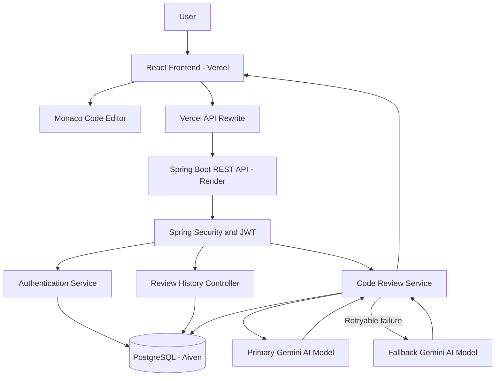
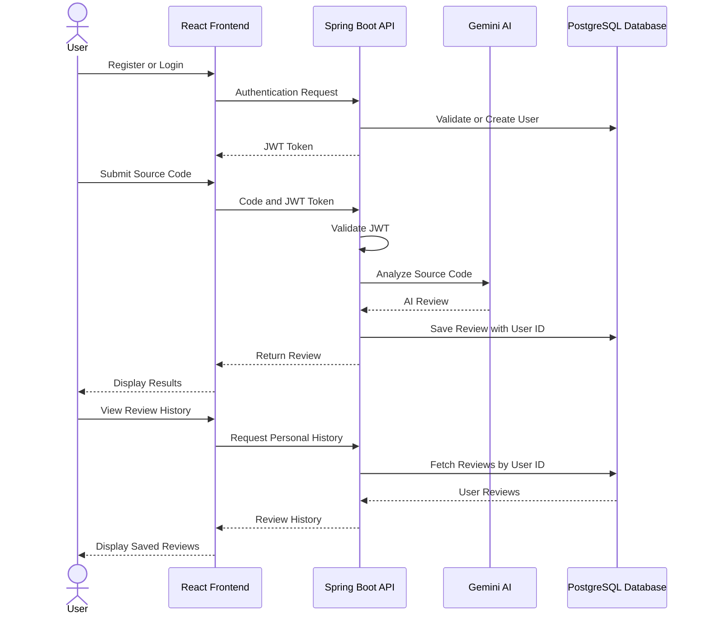
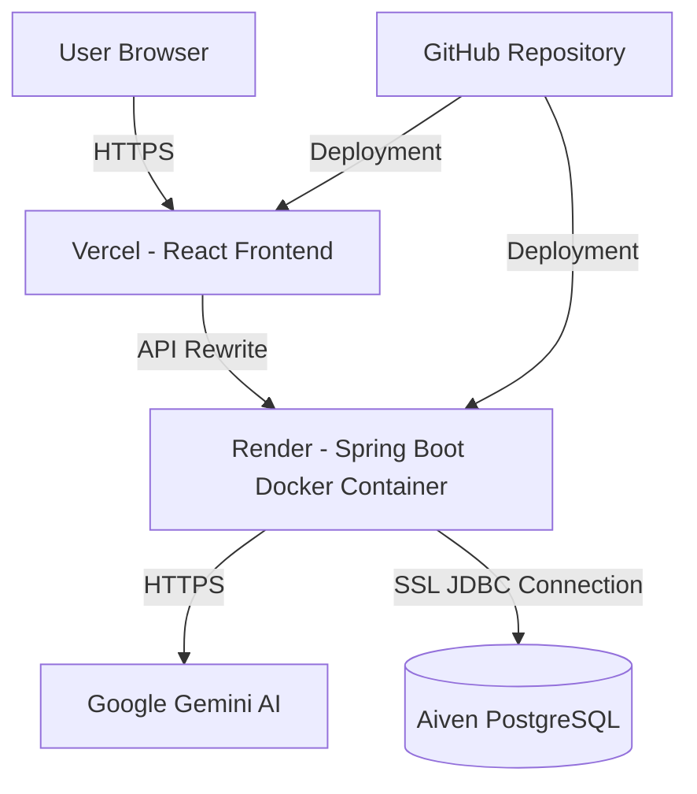
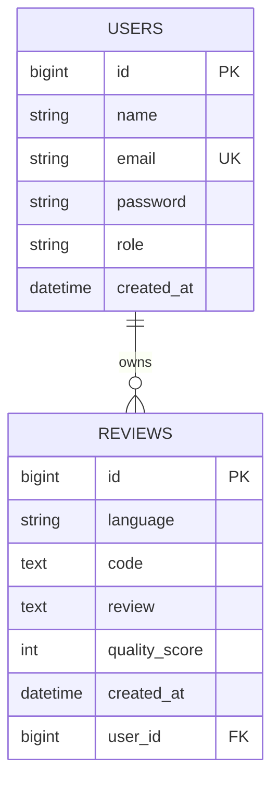
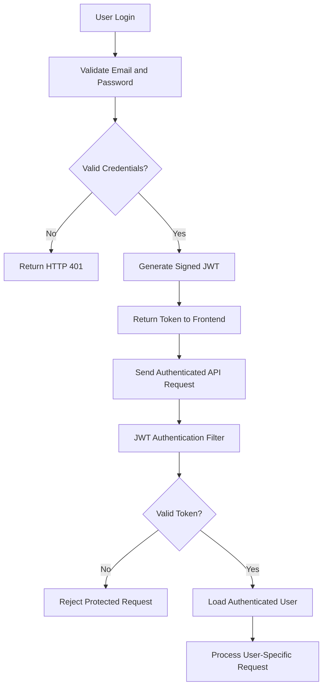
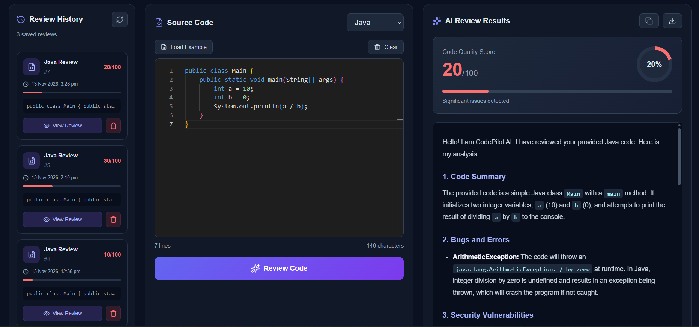
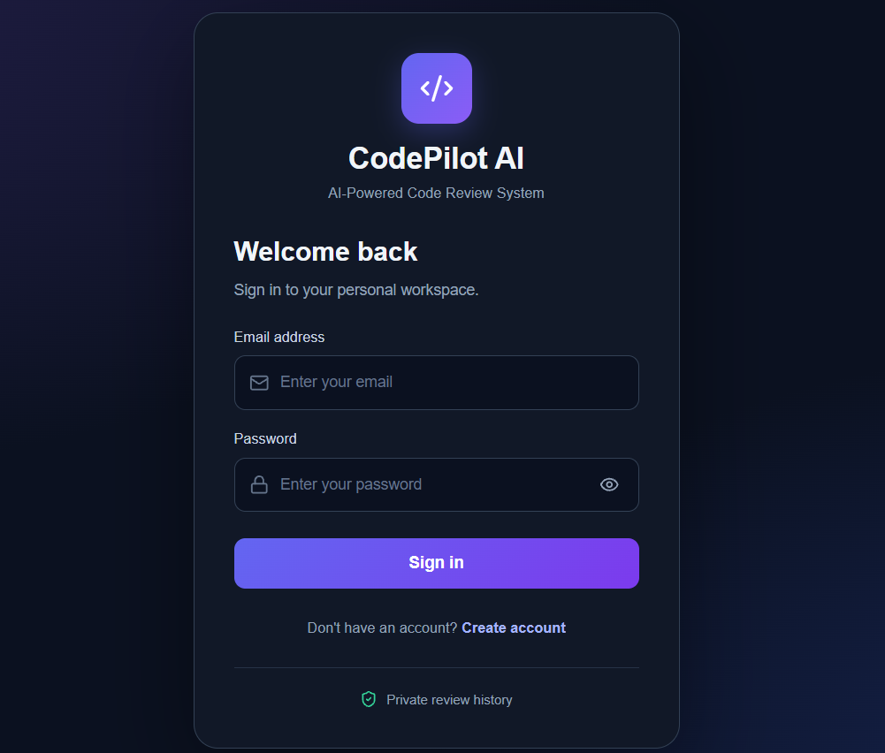
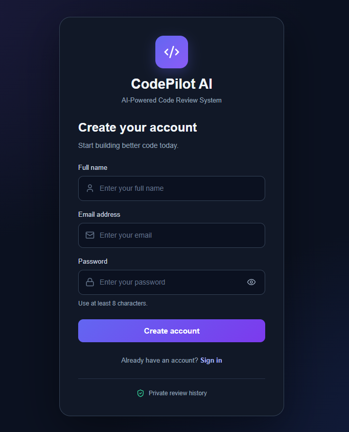
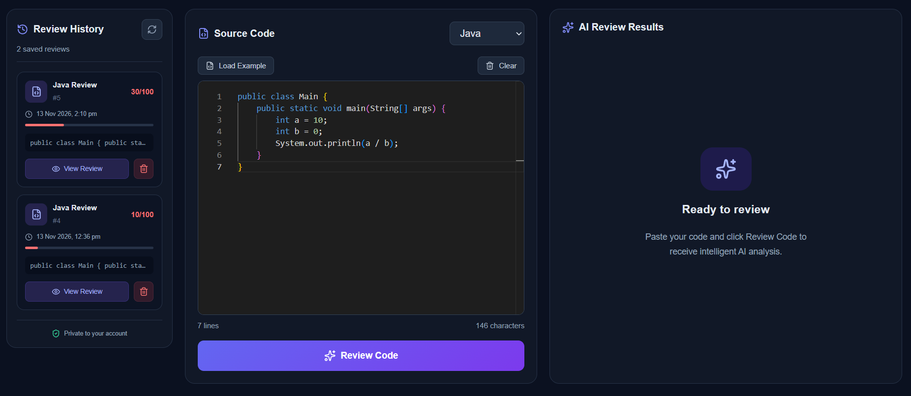

# 🚀 CodePilot AI

### AI-Powered Code Review System

**Write better code. Build with confidence.**

CodePilot AI is a full-stack AI-powered code review platform that helps developers detect bugs, identify security vulnerabilities, improve performance, and enhance code quality using Google Gemini AI.

The platform combines an intelligent AI review engine with a modern code editor, secure authentication, and personalized review history to provide an interactive code analysis experience.

---

## 🌐 Live Demo

🚀 **Try CodePilot AI:** [https://codepilot-ai-blue.vercel.app/](https://codepilot-ai-blue.vercel.app/)

**Backend Health Check:** [https://codepilot-ai-3y5o.onrender.com/api/health](https://codepilot-ai-3y5o.onrender.com/api/health)

CodePilot AI is deployed as a full-stack cloud application. Users can create an account, submit source code, receive AI-generated reviews, and manage their personal review history.

### Cloud Deployment

| Component | Platform |
|-----------|----------|
| Frontend | Vercel |
| Backend | Render |
| Database | Aiven PostgreSQL |
| AI Engine | Google Gemini AI |
| Authentication | JWT + BCrypt |
| Containerization | Docker |
| Version Control | GitHub |

> **Note:** The application uses free cloud hosting. The Render backend may take a minute or longer to wake up after inactivity. The Aiven database may also need to be restarted after extended inactivity.

---

## ✨ Key Features

- 🤖 **AI-Powered Code Review** – Analyze source code using Google Gemini AI.
- 🐛 **Bug Detection** – Identify logical errors, runtime errors, and potential bugs.
- 🔒 **Security Analysis** – Detect potential security vulnerabilities in source code.
- ⚡ **Performance Optimization** – Receive suggestions to improve code efficiency.
- 📊 **Code Quality Score** – Get an AI-generated quality rating out of 100.
- 💡 **Improved Code** – Generate improved code with explanations of changes.
- 📝 **Monaco Code Editor** – Professional code editor with syntax highlighting.
- 🌐 **Multi-Language Support** – Java, Python, JavaScript, TypeScript, C, C++, SQL, HTML, CSS, and more.
- 🔐 **Secure Authentication** – User registration and login using JWT and BCrypt.
- 📚 **Personal Review History** – Save, view, and delete previous AI reviews.
- 👥 **Multi-User Support** – Each user can access only their own reviews.
- 🔄 **AI Model Fallback** – Automatically switch to a backup Gemini model when the primary model encounters supported service errors.
- 📥 **Download and Copy** – Export AI-generated reviews for future reference.
- 🎨 **Modern Responsive UI** – Dark-themed dashboard with an interactive user interface.
- ☁️ **Cloud Deployment** – Access the application online without installing it locally.
- 🧪 **Automated Testing** – 39 backend tests covering authentication, authorization, validation, and application behavior.

---

## 🛠️ Technology Stack

### Frontend

| Technology | Purpose |
|------------|---------|
| React | User interface |
| Vite | Frontend development and build |
| Monaco Editor | Source code editor |
| React Markdown | Display AI-generated reviews |
| Lucide React | UI icons |
| CSS | Styling and responsive design |

### Backend

| Technology | Purpose |
|------------|---------|
| Java 21 | Backend programming language |
| Spring Boot | REST API development |
| Spring Security | Authentication and authorization |
| Spring Data JPA | Database operations |
| Hibernate | Object-relational mapping |
| JWT | Token-based authentication |
| BCrypt | Password hashing |
| Maven | Dependency management and build |

### AI and Database

| Technology | Purpose |
|------------|---------|
| Google Gemini AI | Intelligent code analysis |
| Gemini 3.1 Flash Lite | Primary AI model |
| Gemini 3.5 Flash Lite | Fallback AI model |
| MySQL | Local development database |
| PostgreSQL | Cloud production database |
| H2 | In-memory database for automated testing |

### Deployment and Testing

| Technology | Purpose |
|------------|---------|
| Docker | Backend containerization |
| Render | Spring Boot backend hosting |
| Vercel | React frontend hosting |
| Aiven | Managed PostgreSQL database |
| Git and GitHub | Version control and source code management |
| JUnit | Automated backend testing |
| Mockito | Mocking dependencies in unit tests |
| ESLint | Frontend code quality checks |

---

## 🏗️ System Architecture



### Architecture Overview

1. The user registers or logs in through the React frontend hosted on Vercel.
2. Vercel forwards API requests to the Spring Boot backend hosted on Render.
3. The backend validates credentials and generates a JWT token.
4. The user enters source code using the Monaco editor.
5. The frontend sends an authenticated review request to Spring Boot.
6. The review service sends the source code to Gemini AI.
7. Gemini generates a structured code review with improvement suggestions.
8. If the primary AI model encounters a supported retryable error, the backend attempts to use the fallback model.
9. The backend stores the review in PostgreSQL with the authenticated user's ID.
10. The frontend displays the AI-generated review and updates the personal review history.

### Local and Cloud Architecture

| Component | Local Development | Cloud Deployment |
|-----------|-------------------|------------------|
| Frontend | Vite development server | Vercel |
| Backend | Spring Boot on localhost | Render Docker service |
| Database | MySQL | Aiven PostgreSQL |
| API Routing | Vite proxy | Vercel rewrites |
| AI Engine | Google Gemini AI | Google Gemini AI |

---

## 🔄 Application Workflow



---

## 📂 Project Structure

```text
codepilot-ai/
│
├── frontend/
│   ├── public/
│   ├── src/
│   │   ├── App.jsx
│   │   ├── App.css
│   │   ├── main.jsx
│   │   └── index.css
│   ├── package.json
│   ├── package-lock.json
│   ├── vite.config.js
│   └── vercel.json
│
├── src/
│   ├── main/
│   │   ├── java/com/leamary/codepilotai/
│   │   │   ├── config/
│   │   │   │   └── SecurityConfig.java
│   │   │   ├── controller/
│   │   │   │   ├── AuthController.java
│   │   │   │   ├── ReviewController.java
│   │   │   │   ├── HistoryController.java
│   │   │   │   └── UserController.java
│   │   │   ├── dto/
│   │   │   ├── entity/
│   │   │   │   ├── User.java
│   │   │   │   └── Review.java
│   │   │   ├── exception/
│   │   │   │   └── GlobalExceptionHandler.java
│   │   │   ├── repository/
│   │   │   │   ├── UserRepository.java
│   │   │   │   └── ReviewRepository.java
│   │   │   ├── security/
│   │   │   │   ├── JwtAuthenticationFilter.java
│   │   │   │   └── RequestSizeFilter.java
│   │   │   ├── service/
│   │   │   │   ├── AuthService.java
│   │   │   │   ├── JwtService.java
│   │   │   │   └── ReviewService.java
│   │   │   └── CodepilotAiApplication.java
│   │   └── resources/
│   │       ├── application.properties
│   │       └── application-prod.properties
│   └── test/
│       ├── java/
│       └── resources/
│           └── application-test.properties
│
├── screenshots/
│   ├── dashboard.png
│   ├── login.png
│   ├── register.png
│   ├── editor.png
│   └── history.png
│
├── .mvn/
├── .gitignore
├── .dockerignore
├── Dockerfile
├── mvnw
├── mvnw.cmd
├── pom.xml
└── README.md
```

---

## ⚙️ Installation and Setup

### Prerequisites

Make sure the following tools are installed:

- JDK 21 or a compatible later version
- Node.js and npm
- MySQL Server
- Git
- Google Gemini API key

The Maven Wrapper is included in the project, so a separate Maven installation is not required.

### 1. Clone the Repository

```bash
git clone https://github.com/leamary26/codepilot-ai.git
cd codepilot-ai
```

> The repository is currently private. GitHub authorization is required to clone it.

### 2. Configure MySQL

Create a MySQL database:

```sql
CREATE DATABASE codepilot_ai;
```

Create a dedicated database user:

```sql
CREATE USER 'codepilot_user'@'localhost'
IDENTIFIED BY 'YOUR_DATABASE_PASSWORD';

GRANT SELECT, INSERT, UPDATE, DELETE, CREATE, ALTER,
INDEX, REFERENCES
ON codepilot_ai.*
TO 'codepilot_user'@'localhost';
```

Hibernate automatically creates and updates the required tables during local development.

### 3. Configure Environment Variables

The application uses environment variables to protect sensitive credentials.

| Variable | Description |
|----------|-------------|
| GEMINI_API_KEY | Google Gemini API key |
| DB_PASSWORD | Database user password |
| JWT_SECRET | Base64-encoded JWT signing secret |
| DB_URL | JDBC database URL |
| DB_USERNAME | Database username |
| SPRING_PROFILES_ACTIVE | Spring Boot active profile |
| PORT | Application server port |

For local development, the required variables are:

- GEMINI_API_KEY
- DB_PASSWORD
- JWT_SECRET

The local database URL, database username, and server port have default values in `application.properties`.

Set the required variables in your IDE run configuration or operating system environment.

The JWT secret must contain at least 32 random bytes before Base64 encoding.

### Generate a JWT Secret on Windows

```powershell
$bytes = New-Object byte[] 32
$rng = [System.Security.Cryptography.RandomNumberGenerator]::Create()
$rng.GetBytes($bytes)
[Convert]::ToBase64String($bytes)
$rng.Dispose()
```

Copy the generated value into the `JWT_SECRET` environment variable.

**Never commit real API keys, passwords, or JWT secrets to GitHub.**

### 4. Start the Backend

Using the Maven Wrapper on Windows:

```powershell
.\mvnw.cmd spring-boot:run
```

Alternatively, open the project in IntelliJ IDEA, configure the environment variables, and run `CodepilotAiApplication.java`.

The backend runs at:

```text
http://localhost:8080
```

Health check:

```text
http://localhost:8080/api/health
```

Expected response:

```text
CodePilot AI Backend is running!
```

### 5. Start the Frontend

Open another terminal:

```bash
cd frontend
npm install
npm run dev
```

For Windows PowerShell systems that block npm scripts:

```powershell
npm.cmd install
npm.cmd run dev
```

Open the application:

```text
http://localhost:5173
```

The Vite development proxy forwards API requests to the Spring Boot backend on port 8080.

---

## ☁️ Cloud Deployment

CodePilot AI is deployed using a three-tier cloud architecture.

### 1. Aiven PostgreSQL Database

The production application uses a managed PostgreSQL database hosted on Aiven.

Database configuration:

- PostgreSQL 18
- Free service tier
- 1 CPU
- 1 GB RAM
- 1 GB storage
- Asia Pacific region
- SSL-encrypted database connection

The PostgreSQL JDBC driver is included in the Maven dependencies.

The production database configuration is defined in:

```text
src/main/resources/application-prod.properties
```

The application uses a separate production profile so that the local MySQL database remains independent of the cloud PostgreSQL database.

### 2. Render Backend Deployment

The Spring Boot backend is deployed on Render using Docker.

Deployment configuration:

| Setting | Value |
|---------|-------|
| Runtime | Docker |
| Branch | main |
| Region | Singapore |
| Instance Type | Free |
| RAM | 512 MB |
| Dockerfile | ./Dockerfile |
| Health Check | /api/health |

The Dockerfile uses a multi-stage build:

1. Maven and Java 21 build the executable Spring Boot JAR.
2. A smaller Java 21 runtime image runs the application.
3. The application runs as a non-root user.
4. Java heap memory is limited to help the application run within the free hosting resources.

### Production Environment Variables

The following variables are configured securely in Render:

| Variable | Value |
|----------|-------|
| SPRING_PROFILES_ACTIVE | prod |
| DB_URL | PostgreSQL JDBC connection URL |
| DB_USERNAME | Cloud database username |
| DB_PASSWORD | Cloud database password |
| GEMINI_API_KEY | Google Gemini API key |
| JWT_SECRET | Production JWT signing secret |

Example JDBC URL format:

```text
jdbc:postgresql://YOUR_HOST:YOUR_PORT/defaultdb?sslmode=require
```

Actual credentials are stored in the hosting platform's environment variables and are not included in the repository.

### 3. Vercel Frontend Deployment

The React frontend is deployed on Vercel using the Hobby plan.

Deployment configuration:

| Setting | Value |
|---------|-------|
| Framework | Vite |
| Root Directory | frontend |
| Branch | main |
| Build Command | npm run build |
| Output Directory | dist |

The frontend uses a Vercel rewrite to communicate with the Render backend.

File: `frontend/vercel.json`

```json
{
  "rewrites": [
    {
      "source": "/api/:path*",
      "destination": "https://codepilot-ai-3y5o.onrender.com/api/:path*"
    }
  ]
}
```

This configuration forwards API requests from the frontend to the cloud backend while keeping the frontend's API calls relative to `/api`.

No database passwords, Gemini API keys, or JWT secrets are stored in the frontend.

### Deployment Architecture



### Live Application Links

- **Frontend:** [https://codepilot-ai-blue.vercel.app/](https://codepilot-ai-blue.vercel.app/)
- **Backend:** [https://codepilot-ai-3y5o.onrender.com](https://codepilot-ai-3y5o.onrender.com)
- **Health Check:** [https://codepilot-ai-3y5o.onrender.com/api/health](https://codepilot-ai-3y5o.onrender.com/api/health)

### Hosting Cost

| Platform | Plan | Monthly Hosting Cost |
|----------|------|----------------------|
| Vercel | Hobby | $0 |
| Render | Free | $0 |
| Aiven | Free | $0 |
| Total | Free hosting | $0 |

The application uses free hosting plans for its portfolio demonstration. Gemini API usage is subject to the applicable model quotas and account billing settings.

Free hosting resources may have usage limits, inactivity shutdowns, and cold-start delays.

---

## 📡 REST API Endpoints

### Public Endpoints

| Method | Endpoint | Description |
|--------|----------|-------------|
| GET | /api/health | Check backend status |
| POST | /api/auth/register | Register a new user |
| POST | /api/auth/login | Authenticate a user |

### Protected Endpoints

| Method | Endpoint | Description |
|--------|----------|-------------|
| GET | /api/user/me | Get current user details |
| POST | /api/review | Generate an AI code review |
| GET | /api/history | Get personal review history |
| GET | /api/history/{id} | Get a specific owned review |
| DELETE | /api/history/{id} | Delete a specific owned review |

Protected endpoints require a valid JWT token:

```http
Authorization: Bearer YOUR_JWT_TOKEN
```

### Example Registration Request

Endpoint:

```http
POST /api/auth/register
```

Request body:

```json
{
  "name": "Demo User",
  "email": "demo@example.com",
  "password": "YOUR_PASSWORD"
}
```

### Example Login Request

Endpoint:

```http
POST /api/auth/login
```

Request body:

```json
{
  "email": "demo@example.com",
  "password": "YOUR_PASSWORD"
}
```

### Example Code Review Request

Endpoint:

```http
POST /api/review
```

Request body:

```json
{
  "language": "Java",
  "code": "public class Main { public static void main(String[] args) { int a = 10; int b = 0; System.out.println(a / b); } }"
}
```

The AI analyzes the code and returns a Markdown-formatted review containing:

1. Code Summary
2. Bugs and Errors
3. Security Vulnerabilities
4. Performance Improvements
5. Code Quality Score
6. Improved Code
7. Explanation of Changes

### Example Review Result

For the Java example above, the AI can identify:

- Division by zero.
- Potential ArithmeticException.
- Missing validation before performing division.
- Suggestions for handling invalid input.
- Improved Java code with appropriate checks.

The generated quality score is an AI-based estimate and may vary between reviews of the same code.

---

## 🗄️ Database Design

The application uses two main database tables.

### Users Table

| Field | Description |
|-------|-------------|
| id | Unique user ID |
| name | User's name |
| email | Unique email address |
| password | BCrypt password hash |
| role | User role |
| created_at | Account creation timestamp |

### Reviews Table

| Field | Description |
|-------|-------------|
| id | Unique review ID |
| language | Programming language |
| code | Submitted source code |
| review | AI-generated review |
| quality_score | Code quality score |
| created_at | Review creation timestamp |
| user_id | Foreign key referencing users |

### Entity Relationship Diagram



A registered user can own multiple reviews. All newly generated reviews are linked to their authenticated owner.

Legacy reviews created before authentication was introduced may have a null user ID. These records are not accessible through the user-specific history endpoints.

### Database Compatibility

The application supports:

- MySQL for local development.
- PostgreSQL for cloud deployment.
- H2 for automated tests.

Hibernate and Spring Data JPA provide database-independent entity mapping.

Large source code and AI review fields use Hibernate's large text mapping to support both MySQL and PostgreSQL.

---

## 🔐 Authentication and Security

CodePilot AI implements JWT-based authentication using Spring Security.

### Implemented Security Features

- Passwords are hashed using BCrypt before being stored.
- Successful authentication generates a signed JWT token.
- Protected APIs validate the token before processing requests.
- Review history is filtered using the authenticated user's ID.
- Users cannot access or delete reviews belonging to other accounts.
- Unauthenticated requests to protected endpoints return HTTP 401.
- Requests for another user's review return HTTP 404.
- Sensitive configuration values are supplied through environment variables.
- Default Spring Security user authentication is disabled.
- Input validation is implemented for registration, login, and code review requests.
- Source code length is limited to 20,000 characters.
- Review request bodies are limited to 256 KB.
- Registration and login request bodies are limited to 16 KB.
- Global exception handling provides controlled error responses.
- Detailed stack traces and internal error information are not exposed in production error responses.
- The backend Docker container runs as a non-root user.

### JWT Authentication Flow



### Session Management

The current frontend keeps the JWT in application memory.

Refreshing the page requires signing in again. Logging out clears the token from the frontend and removes the current user's dashboard state.

The backend uses stateless JWT authentication. Tokens expire after the configured expiration period.

Server-side token revocation and more advanced session management are planned future improvements.

### Production Security Considerations

CodePilot AI is currently a working portfolio demonstration.

Additional security improvements planned before wider public use include:

- API rate limiting and abuse prevention.
- Stronger database TLS certificate verification.
- Advanced session management and token revocation.
- Additional integration and security testing.
- Improved production error handling and monitoring.

---

## 🧪 Testing and Verification

### Automated Backend Tests

A total of **39 automated backend tests** have been implemented and successfully executed.

| Test Class | Number of Tests |
|------------|-----------------|
| JwtServiceTest | 5 |
| PasswordEncoderTest | 4 |
| AuthServiceTest | 7 |
| HistoryControllerTest | 6 |
| ReviewServiceTest | 8 |
| RequestSizeFilterTest | 8 |
| CodepilotAiApplicationTests | 1 |
| Total | 39 |

The automated tests cover:

- JWT generation and validation.
- Invalid and expired token handling.
- Password hashing and verification.
- User registration and login.
- Duplicate account handling.
- Invalid authentication requests.
- User-specific review history.
- Cross-account access protection.
- Code review input validation.
- Request size limits.
- Spring Boot application context startup.

### Run Backend Tests

```powershell
.\mvnw.cmd test
```

Test result:

```text
Tests run: 39
Failures: 0
Errors: 0
Skipped: 0

BUILD SUCCESS
```

The test configuration uses an H2 in-memory database, allowing tests to run independently of the local MySQL and cloud PostgreSQL databases.

### Local Testing

| Test | Status |
|------|--------|
| User registration | Passed |
| User login | Passed |
| Password hashing | Passed |
| JWT authentication | Passed |
| AI code review generation | Passed |
| AI model fallback simulation | Passed |
| MySQL review storage | Passed |
| Personal review history | Passed |
| Multiple user accounts | Passed |
| Cross-account viewing protection | Passed |
| Cross-account deletion protection | Passed |
| Unauthorized API access | Passed |
| Invalid code review input | Passed |
| Request size validation | Passed |
| Frontend lint check | Passed |
| Frontend production build | Passed |
| Backend JAR packaging | Passed |

### Cloud Testing

The deployed application has also been tested using the live Vercel frontend, Render backend, and Aiven PostgreSQL database.

| Cloud Test | Status |
|------------|--------|
| Vercel frontend deployment | Passed |
| Render backend deployment | Passed |
| Live backend health endpoint | Passed |
| Frontend-to-backend API communication | Passed |
| Cloud account registration | Passed |
| Cloud user login | Passed |
| Gemini AI code review generation | Passed |
| Code quality score display | Passed |
| PostgreSQL review storage | Passed |
| Personal review history display | Passed |
| Logout and login persistence | Passed |
| Second-account history isolation | Passed |
| Review deletion | Passed |

### Frontend Code Quality

The React frontend has been checked using ESLint and successfully built for production.

```powershell
cd frontend
npm.cmd run lint
npm.cmd run build
```

### Testing Summary

- 39 automated backend tests passed.
- Local application workflow verified.
- Cloud application workflow verified.
- Authentication and user-specific review history verified.
- Cloud database persistence and review deletion verified.

The AI fallback path was tested using a simulated retryable failure. Additional end-to-end and production security testing remains a future improvement.

---

## 📸 Application Screenshots

### AI Code Review Dashboard

The main dashboard combines a professional code editor, AI-generated analysis, code quality scoring, and personalized review history.



### Login and Registration

Secure user authentication with a modern dark-themed interface.

| Login Page | Registration Page |
|:---:|:---:|
|  |  |

### Source Code Editor

Monaco-powered editor with syntax highlighting, multiple programming languages, example code, and real-time line and character counts.



### Personal Review History

Users can view and delete their own saved AI reviews, including quality scores and timestamps.


---

## 📦 Production Build

### Frontend

```bash
cd frontend
npm run build
```

For Windows PowerShell:

```powershell
cd frontend
npm.cmd run build
```

The optimized frontend files are generated in:

```text
frontend/dist
```

### Backend

To run the automated tests and package the application:

```powershell
.\mvnw.cmd clean package
```

To package the application after tests have already been verified:

```powershell
.\mvnw.cmd clean package -DskipTests
```

The executable Spring Boot JAR is generated in:

```text
target/codepilot-ai-0.0.1-SNAPSHOT.jar
```

### Docker Build

The backend can be packaged into a Docker image using:

```bash
docker build -t codepilot-ai-backend .
```

Run the container with the required production environment variables:

```bash
docker run --env-file .env -p 8080:8080 codepilot-ai-backend
```

The `.env` file must contain the required environment variables and must not be committed to GitHub.

Docker installation is required only for building and running the container locally. Render builds the Docker image directly from the GitHub repository during cloud deployment.

---

## 💡 Challenges and Solutions

### 1. AI Model Availability

**Challenge:** The primary Gemini model may experience temporary service errors or availability issues.

**Solution:** Implemented a fallback mechanism that attempts to use a secondary Gemini model when supported retryable errors occur.

### 2. User Data Privacy

**Challenge:** Multiple users need to store their reviews without accessing other users' data.

**Solution:** Implemented JWT authentication and user-specific database queries that restrict review access to the authenticated owner.

### 3. Database Compatibility

**Challenge:** The local application uses MySQL, while the deployed application uses PostgreSQL.

**Solution:** Used Spring Data JPA, Hibernate, database-independent entity mapping, and separate Spring Boot configuration profiles.

### 4. Frontend and Backend Communication

**Challenge:** The frontend and backend are hosted on different cloud platforms.

**Solution:** Used the Vite development proxy locally and Vercel API rewrites in the deployed application.

### 5. Free Cloud Hosting

**Challenge:** Deploying a Java backend with limited memory and no monthly hosting budget.

**Solution:** Used a multi-stage Docker build, a smaller Java runtime image, a limited Java heap, and free cloud hosting services.

### 6. Application Security

**Challenge:** Protecting user credentials, API keys, and review endpoints.

**Solution:** Implemented BCrypt password hashing, JWT authentication, environment-based secret management, input validation, request size limits, and controlled error responses.

---

## 🚧 Future Enhancements

- GitHub repository integration for automated code reviews.
- Pull request analysis and review suggestions.
- Side-by-side original and improved code comparison.
- AI-powered test case generation.
- Code complexity and maintainability metrics.
- Improved session management and token revocation.
- API rate limiting and abuse prevention.
- Additional end-to-end integration and security testing.
- Stronger database TLS certificate verification.
- Improved production monitoring and error handling.
- Review filtering and search functionality.
- Export reviews as PDF reports.
- Support for reviewing multiple source code files.

---

## 👩‍💻 Developer

**Lea Mary T J**

Computer Science and Engineering

GitHub: [leamary26](https://github.com/leamary26)

Live Project: [CodePilot AI](https://codepilot-ai-blue.vercel.app/)

---

## 📌 Project Status

### Completed and Deployed

CodePilot AI has successfully completed its core development, automated testing, documentation, and cloud deployment.

### Completed Milestones

- Full-stack application development.
- AI-powered code review integration.
- JWT-based authentication.
- User-specific review history.
- Local MySQL database integration.
- Cloud PostgreSQL database integration.
- 39 automated backend tests.
- Frontend lint and production build verification.
- Docker containerization.
- Backend deployment on Render.
- Frontend deployment on Vercel.
- Live application testing.
- Cloud account privacy and review persistence verification.
- GitHub documentation and application screenshots.

The application is available online as a working portfolio demonstration.

Additional production security hardening and advanced features are planned as future improvements.

---

⭐ If you find this project interesting, consider giving it a star!
