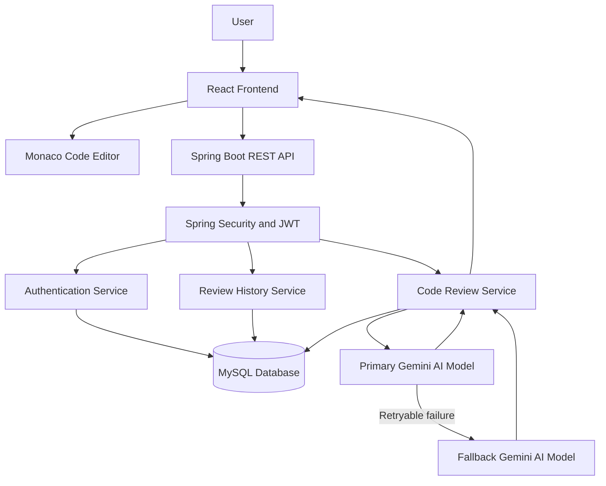
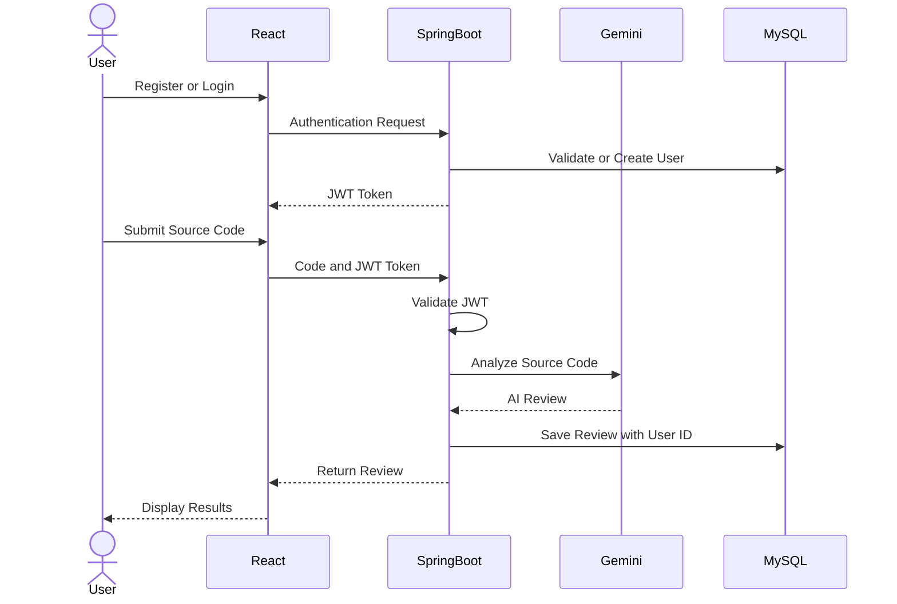
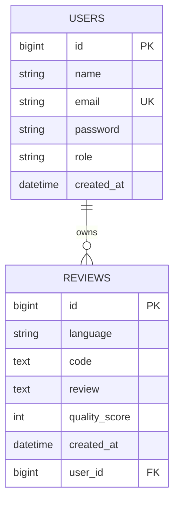
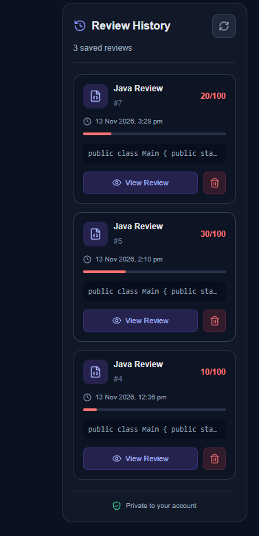

# 🚀 CodePilot AI

### AI-Powered Code Review System

**Write better code. Build with confidence.**

CodePilot AI is a full-stack AI-powered code review platform that helps developers detect bugs, identify security vulnerabilities, improve performance, and enhance code quality using Google Gemini AI.

The platform combines an intelligent AI review engine with a modern code editor, secure authentication, and personalized review history to provide an interactive code analysis experience.

---

## Live Demo

🚀 **Try CodePilot AI:** [https://codepilot-ai-blue.vercel.app/](https://codepilot-ai-blue.vercel.app/)

CodePilot AI is a fully deployed AI-powered code review platform that helps developers detect bugs, identify security vulnerabilities, improve performance, and generate optimized code using Google Gemini AI.

### Cloud Deployment

| Component | Platform |
|-----------|----------|
| Frontend | Vercel |
| Backend | Render |
| Database | Aiven PostgreSQL |
| AI Engine | Google Gemini |
| Authentication | JWT + BCrypt |

> **Note:** The application uses free cloud hosting. The backend may take a minute to wake up after inactivity.

### Testing Status

- 39 automated backend tests passed.
- Live registration and login verified.
- AI code review generation verified.
- Cloud database persistence verified.
- User-specific review history and account privacy verified.
- Review deletion verified.

---

## ✨ Key Features

- 🤖 **AI-Powered Code Review** – Analyze source code using Google Gemini AI.
- 🐛 **Bug Detection** – Identify logical errors, runtime errors, and potential bugs.
- 🔒 **Security Analysis** – Detect potential security vulnerabilities in source code.
- ⚡ **Performance Optimization** – Receive suggestions to improve code efficiency.
- 📊 **Code Quality Score** – Get a quality rating out of 100.
- 💡 **Improved Code** – Generate improved code with explanations of changes.
- 📝 **Monaco Code Editor** – Professional code editor with syntax highlighting.
- 🌐 **Multi-Language Support** – Java, Python, JavaScript, TypeScript, C, C++, SQL, HTML, CSS, and more.
- 🔐 **Secure Authentication** – User registration and login using JWT and BCrypt.
- 📚 **Personal Review History** – Save, view, and delete previous AI reviews.
- 👥 **Multi-User Support** – Each user can access only their own reviews.
- 🔄 **AI Model Fallback** – Automatically switch to a backup Gemini model when the primary model encounters supported service errors.
- 📥 **Download and Copy** – Export AI-generated reviews for future reference.
- 🎨 **Modern Responsive UI** – Dark-themed dashboard with an interactive user interface.

---

## 🛠️ Technology Stack

### Frontend

| Technology | Purpose |
|------------|---------|
| React | User interface |
| Vite | Frontend development and build |
| Monaco Editor | Source code editor |
| React Markdown | Display AI-generated reviews |
| Lucide React | UI icons |
| CSS | Styling and responsive design |

### Backend

| Technology | Purpose |
|------------|---------|
| Java 21 | Backend programming language |
| Spring Boot | REST API development |
| Spring Security | Authentication and authorization |
| Spring Data JPA | Database operations |
| Hibernate | Object-relational mapping |
| JWT | Token-based authentication |
| BCrypt | Password hashing |
| Maven | Dependency management and build |

### AI and Database

| Technology | Purpose |
|------------|---------|
| Google Gemini AI | Intelligent code analysis |
| Gemini 3.1 Flash Lite | Primary AI model |
| Gemini 3.5 Flash Lite | Fallback AI model |
| MySQL | User and review data storage |

---

## 🏗️ System Architecture



### Architecture Overview

1. The user registers or logs in through the React frontend.
2. The backend validates credentials and generates a JWT token.
3. The user enters source code using the Monaco editor.
4. The frontend sends an authenticated review request to Spring Boot.
5. The review service sends the source code to Gemini AI.
6. Gemini generates a structured code review with improvement suggestions.
7. The backend stores the review in MySQL with the authenticated user's ID.
8. The frontend displays the AI-generated review and updates the personal history.

---

## 🔄 Application Workflow



---

## 📂 Project Structure

```text
codepilot-ai/
│
├── frontend/
│   ├── public/
│   ├── src/
│   │   ├── App.jsx
│   │   ├── App.css
│   │   ├── main.jsx
│   │   └── index.css
│   ├── package.json
│   └── vite.config.js
│
├── src/
│   ├── main/
│   │   ├── java/com/leamary/codepilotai/
│   │   │   ├── config/
│   │   │   ├── controller/
│   │   │   ├── dto/
│   │   │   ├── entity/
│   │   │   ├── repository/
│   │   │   ├── security/
│   │   │   ├── service/
│   │   │   └── CodepilotAiApplication.java
│   │   └── resources/
│   │       └── application.properties
│   └── test/
│
├── .gitignore
├── mvnw
├── mvnw.cmd
├── pom.xml
└── README.md
```

---

## ⚙️ Installation and Setup

### Prerequisites

Make sure the following tools are installed:

- JDK 21 or later compatible version
- Node.js and npm
- MySQL Server
- Git
- Google Gemini API key

The Maven Wrapper is included in the project, so a separate Maven installation is not required.

### 1. Clone the Repository

```bash
git clone https://github.com/leamary26/codepilot-ai.git
cd codepilot-ai
```

### 2. Configure MySQL

Create a MySQL database:

```sql
CREATE DATABASE codepilot_ai;
```

Create a dedicated database user:

```sql
CREATE USER 'codepilot_user'@'localhost'
IDENTIFIED BY 'YOUR_DATABASE_PASSWORD';

GRANT SELECT, INSERT, UPDATE, DELETE, CREATE, ALTER,
INDEX, REFERENCES
ON codepilot_ai.*
TO 'codepilot_user'@'localhost';
```

Hibernate automatically creates and updates the required tables during local development.

### 3. Configure Environment Variables

The application uses environment variables to protect sensitive credentials.

| Variable | Description |
|----------|-------------|
| GEMINI_API_KEY | Google Gemini API key |
| DB_PASSWORD | MySQL database user password |
| JWT_SECRET | Base64-encoded JWT signing secret |

Set these variables in your IDE run configuration or operating system environment.

The JWT secret must contain at least 32 random bytes before Base64 encoding.

Never commit real API keys, passwords, or JWT secrets to GitHub.

### 4. Start the Backend

Using the Maven Wrapper on Windows:

```powershell
.\mvnw.cmd spring-boot:run
```

Alternatively, open the project in IntelliJ IDEA, configure the environment variables, and run `CodepilotAiApplication.java`.

The backend runs at:

```text
http://localhost:8080
```

Health check:

```text
http://localhost:8080/api/health
```

### 5. Start the Frontend

Open another terminal:

```bash
cd frontend
npm install
npm run dev
```

For Windows PowerShell systems that block npm scripts:

```powershell
npm.cmd install
npm.cmd run dev
```

Open the application:

```text
http://localhost:5173
```

The Vite development proxy forwards API requests to the Spring Boot backend on port 8080.

---

## 📡 REST API Endpoints

### Public Endpoints

| Method | Endpoint | Description |
|--------|----------|-------------|
| GET | /api/health | Check backend status |
| POST | /api/auth/register | Register a new user |
| POST | /api/auth/login | Authenticate a user |

### Protected Endpoints

| Method | Endpoint | Description |
|--------|----------|-------------|
| GET | /api/user/me | Get current user details |
| POST | /api/review | Generate an AI code review |
| GET | /api/history | Get personal review history |
| GET | /api/history/{id} | Get a specific owned review |
| DELETE | /api/history/{id} | Delete a specific owned review |

Protected endpoints require a valid JWT token:

```http
Authorization: Bearer YOUR_JWT_TOKEN
```

### Example Code Review Request

```json
{
  "language": "Java",
  "code": "public class Main { public static void main(String[] args) { int a = 10; int b = 0; System.out.println(a / b); } }"
}
```

The AI analyzes the code and returns a Markdown-formatted review containing:

1. Code Summary
2. Bugs and Errors
3. Security Vulnerabilities
4. Performance Improvements
5. Code Quality Score
6. Improved Code
7. Explanation of Changes

---

## 🗄️ Database Design

The application uses two main database tables.

### Users Table

| Field | Description |
|-------|-------------|
| id | Unique user ID |
| name | User's name |
| email | Unique email address |
| password | BCrypt password hash |
| role | User role |
| created_at | Account creation timestamp |

### Reviews Table

| Field | Description |
|-------|-------------|
| id | Unique review ID |
| language | Programming language |
| code | Submitted source code |
| review | AI-generated review |
| quality_score | Code quality score |
| created_at | Review creation timestamp |
| user_id | Foreign key referencing users |

### Entity Relationship Diagram



A registered user can own multiple reviews. Newly generated reviews are linked to their authenticated owner.

---

## 🔐 Authentication and Security

CodePilot AI implements JWT-based authentication using Spring Security.

- Passwords are hashed using BCrypt before being stored.
- Successful authentication generates a signed JWT token.
- Protected APIs validate the token before processing requests.
- Review history is filtered using the authenticated user's ID.
- Users cannot access or delete reviews belonging to other accounts.
- Unauthorized requests return HTTP 401.
- Requests for another user's review return HTTP 404.
- Sensitive configuration values are supplied through environment variables.

The current frontend keeps the JWT in application memory. Refreshing the page requires signing in again.

---

## 🧪 Testing and Verification

The following local tests have been completed:

| Test | Status |
|------|--------|
| User registration | Passed |
| User login | Passed |
| Password hashing | Passed |
| JWT authentication | Passed |
| AI code review generation | Passed |
| AI model fallback | Passed |
| MySQL review storage | Passed |
| Personal review history | Passed |
| Multiple user accounts | Passed |
| Cross-account viewing protection | Passed |
| Cross-account deletion protection | Passed |
| Unauthorized API access | Passed |
| Frontend production build | Passed |
| Backend JAR packaging | Passed |

The backend packaging check was performed with automated tests skipped. Additional automated testing and production security hardening are planned.

---

## 📸 Application Screenshots


## 📸 Application Screenshots

### AI Code Review Dashboard

The main dashboard combines a professional code editor, AI-generated analysis, code quality scoring, and personalized review history.


### Login and Registration

Secure user authentication with a modern dark-themed interface.

| Login Page | Registration Page |
|:---:|:---:|
|  |  |

### Source Code Editor

Monaco-powered editor with syntax highlighting, multiple programming languages, example code, and real-time line and character counts.


### Personal Review History

Users can view and delete their own saved AI reviews, including quality scores and timestamps.



---


---

## 📦 Production Build

### Frontend

```bash
cd frontend
npm run build
```

The optimized frontend files are generated in `frontend/dist`.

### Backend

```powershell
.\mvnw.cmd clean package -DskipTests
```

The executable Spring Boot JAR is generated in:

```text
target/codepilot-ai-0.0.1-SNAPSHOT.jar
```

Production hosting requires appropriate environment variables, database configuration, API routing, HTTPS, and additional security configuration.

---

## 🚧 Future Enhancements

- GitHub repository integration for automated code reviews.
- Pull request analysis and review suggestions.
- Side-by-side code comparison.
- AI-powered test case generation.
- Code complexity and maintainability metrics.
- Improved session management.
- Automated unit and integration testing.
- API rate limiting and production security hardening.
- Cloud deployment with a live application demo.

---

## 👩‍💻 Developer

**Lea Mary T J**

Computer Science and Engineering

GitHub: [leamary26](https://github.com/leamary26)

---

## 📌 Project Status

Core application development is complete and verified locally.

Documentation, automated testing, production hardening, and cloud deployment are in progress.

---

⭐ If you find this project interesting, consider giving it a star!
